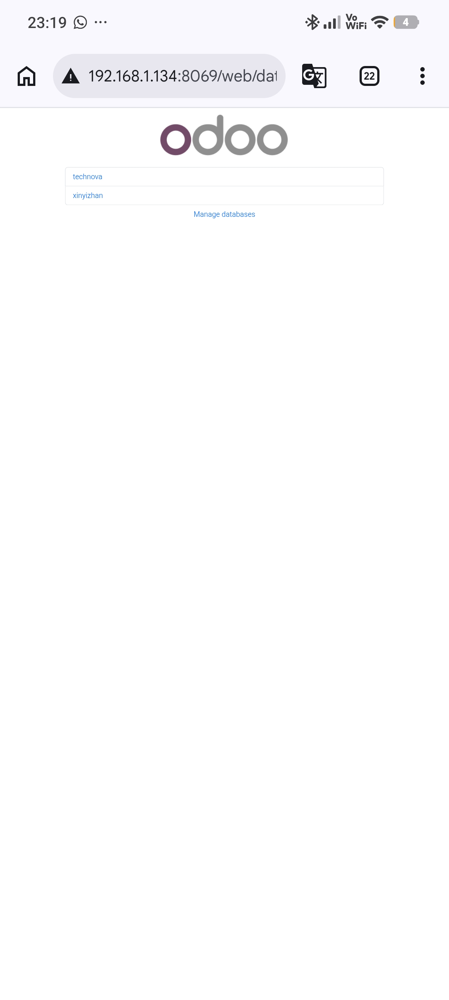

# Activitat 2.3 — Tipus d'instal·lació d'un ERP-CRM

## MÒDUL: Desenvolupament d'aplicacions multiplataforma

RA2: Implanta sistemes ERP-CRM interpretant la documentació tècnica i identificant les diferents opcions i mòduls.

## RECURSOS

 - Teoria RA2

## CONDICIONS DE TREBALL

 - Treball individual.
 - Entregar al Moodle l'enllaç del github.
 - Github:
   - Treballar en el mateix repositori de la **RA1**.
   - Treballar en la branca **ra2**.
   - En acabar l'activitat, fusionar la branca **ra2** a la branca **main** del github.    

## AVALUACIÓ

 - Activitat avaluable amb **A** (Apte) o **NA** (No Apte).
 - Condicions per a **Apte**:
   - 100% de l'activitat demanada.
   - Entregar l'activitat a la data indicada.
   - Treballar amb branca i l'ús de commits.
 - Entregar en format **.md** (markdown) amb la mateixa nomenclatura que el de l'activitat actual.

## ENUNCIAT

### 1. Comparativa teòrica

Ompliu una taula comparant els tres tipus d'instal·lació:

| Tipus | Descripció breu | Avantatges | Inconvenients | Exemple d'ús típic |
| :---- | :---- | :---- | :---- | :---- |
| Monolloc |Tot el sistema (interfície, lògica i base de dades) viu en un sol ordinador |És la opció més senzilla i econòmica, ideal per a autònoms o microempreses amb un sol lloc de treball. |només s’hi pot treballar des d’ell.  |Una fisioterapeuta autònoma que porta les cites i factures des d’un sol ordinador. |
| Client-servidor | La base de dades (i sovint la lògica) resideix en un servidor central de la xarxa local, i els usuaris hi accedeixen des dels seus equips.  | Permet treball multiusuari i informació centralitzada| exigeix mantenir la infraestructura pròpia. | Una empresa amb 15 empleats a la mateixa oficina que comparteixen un programa de gestió instal·lat en un servidor.|
| Al núvol | El sistema s’allotja en servidors externs i s’hi accedeix per internet des de qualsevol lloc, normalment amb un navegador. |Evita gran part de la infraestructura pròpia i facilita l’accés remot i l’escalabilitat | depèn de la connexió a internet i d’un proveïdor extern.| Una cadena de botigues que gestiona vendes i estoc des del navegador, estiguin on estiguin.|

### 2. Identificació de la vostra instal·lació actual

La instal·lació d'Odoo amb Docker que heu fet servir durant el curs (contenidor `odoo` + contenidor `db`, accessible des del vostre navegador):

1. A quin dels tres tipus s'assembla més? Justifiqueu-ho.

**RESPOSTA:** Monolloc. Perque el sistema (el contenidor odoo i el contenidor db amb la base de dades) s’executa en un únic ordinador que es del meu. Hi accedeixo des del navegador amb "localhost:8069", de manera que només hi puc treballar des d’aquest equip. Tot i que hi ha dos contenidors separats, tots dos corren a la mateixa màquina i no estan pensats per a ser usats per altres usuaris.

2. Quins elements farien que fos "al núvol" de veritat (en lloc de local)?

**RESPOSTA:** 
Primer allotjar-lo en un servidor extern, despres

IP pública i domini: que sigui accessible des d’internet amb una adreça com erp.empresa.com, i no només des de localhost.

Escalabilitat: poder ampliar recursos (CPU, memòria, disc) segons les necessitats.

## 2. Identificació de la vostra instal·lació actual

### 1. A quin dels tres tipus s'assembla més? Justifiqueu-ho.

**RESPOSTA:** Monolloc. Perquè el sistema (el contenidor `odoo` i el contenidor `db` amb la base de dades) s'executa en un únic ordinador, que és el meu. Hi accedeixo des del navegador amb `localhost:8069`, de manera que només hi puc treballar des d'aquest equip. Tot i que hi ha dos contenidors separats, tots dos corren a la mateixa màquina i no estan pensats per a ser usats per altres usuaris.

### 2. Quins elements farien que fos "al núvol" de veritat (en lloc de local)?

**RESPOSTA:**

- **Allotjar-lo en un servidor extern**, en lloc de al meu ordinador.
- **IP pública i domini**: que sigui accessible des d'internet amb una adreça com erp.empresa.com, i no només des de localhost.
- **Escalabilitat**: poder ampliar recursos (CPU, memòria, disc) segons les necessitats.

| Aspecte | Instal·lació actual (Docker local) | Al núvol de veritat |
| :---- | :---- | :---- |
| **On s'executa** | Al meu ordinador | En servidors externs (AWS, Azure, VPS...) |
| **Accés** | Només des del meu equip (localhost:8069) | Des de qualsevol lloc amb internet i un navegador |
| **Adreça** | localhost o IP local | IP pública i domini (erp.empresa.com) |
| **Escalabilitat** | Limitada als recursos del meu equip | Es poden ampliar CPU, memòria |
### 3. Passar de Monolloc a Client-servidor

Suposeu que un company vostre, a la mateixa xarxa local, vol accedir també al vostre Odoo des del seu ordinador.

1. Seguiu els passos ja vistos a la teoria (RA2) per **compartir l'accés a l'Odoo a través de la xarxa local** (regles de firewall, IP i port).
2. Comproveu, des d'un altre dispositiu de la mateixa xarxa (mòbil, un altre PC), que podeu accedir-hi.

   **IMPORTANT!!** Si a la xarxa del centre els dispositius no es veuen entre ells, feu la prova connectant els dos dispositius a la xarxa de dades mòbils d’un mòbil (punt d’accés) o feu-la a casa.

3. Expliqueu per què, un cop fet això, la vostra instal·lació ha passat de comportar-se com un **monolloc** a comportar-se com un **client-servidor**.

Abans, Odoo només era accessible des del mateix ordinador on s'executava (`localhost`), per tant era un monolloc: un únic equip feia de servidor i de client alhora.

Ara, després d'obrir el port 8069 al firewall i accedir-hi per la IP de la xarxa local, el meu ordinador fa de **servidor** i altres dispositius de la xarxa, com el mòbil, hi accedeixen com a **clients** des del navegador amb el IP i el localhost, i per tant és el funcionament d'un sistema **client-servidor**.
## Com entregar-ho

La taula comparativa, les respostes de l'apartat 2, i una captura de l'accés des de l'altre dispositiu de l'apartat 3.

