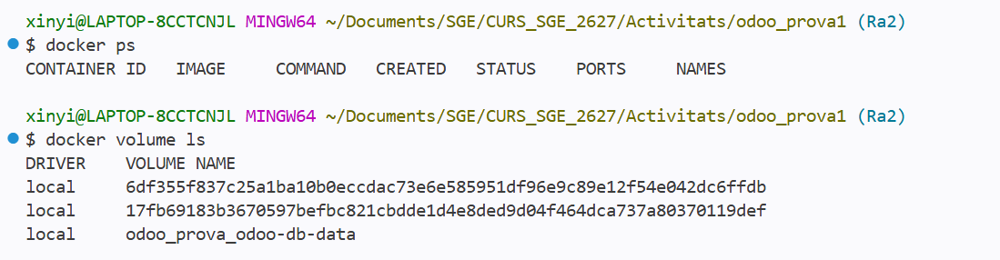
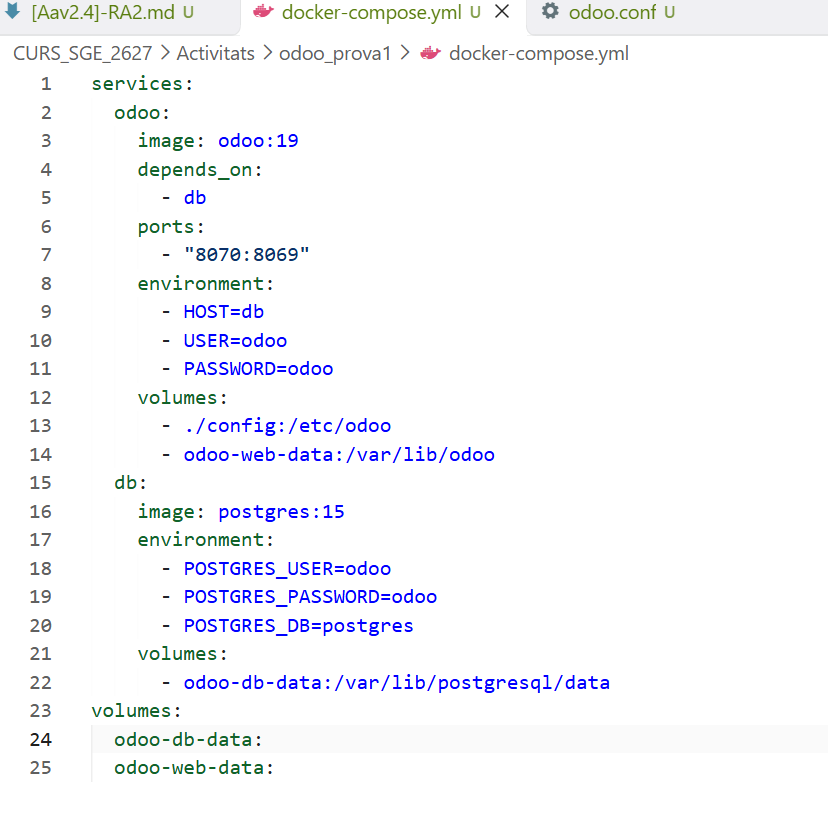
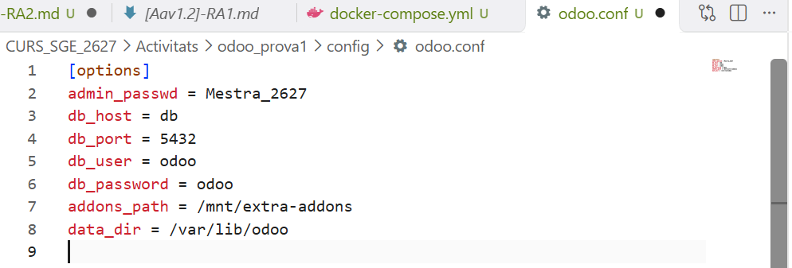
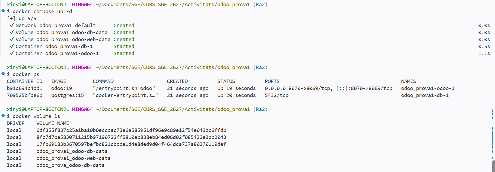
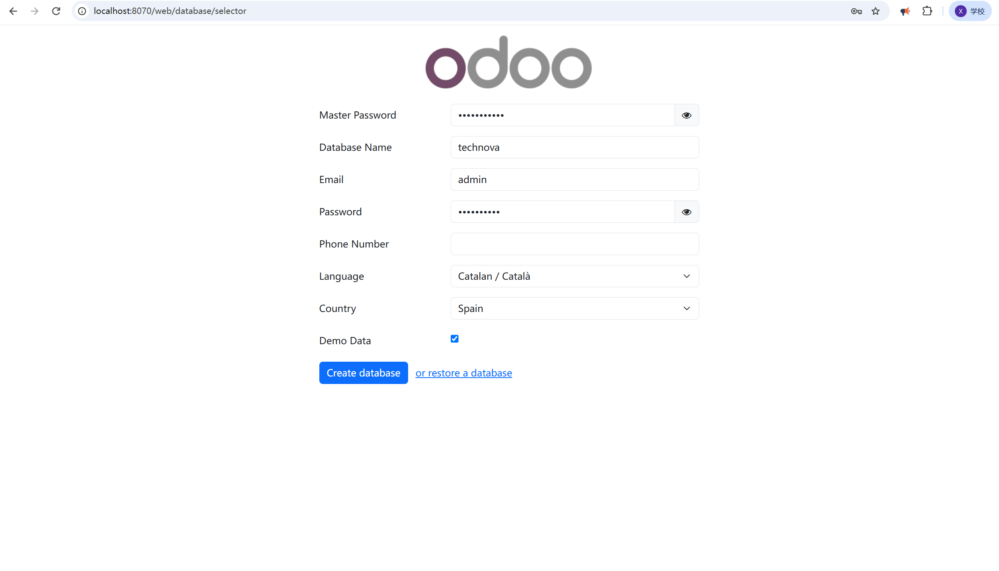
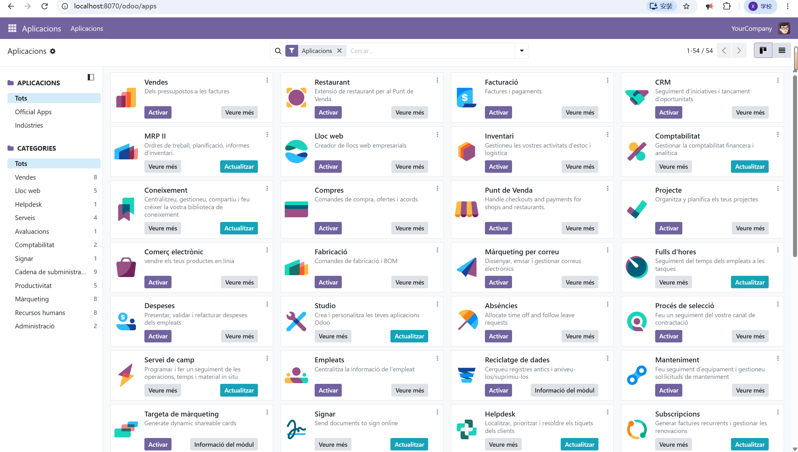
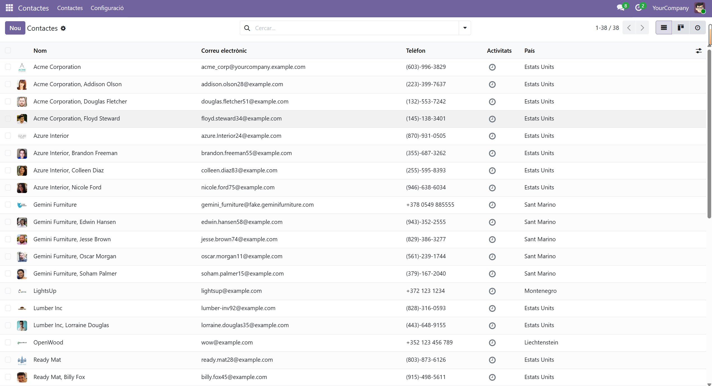
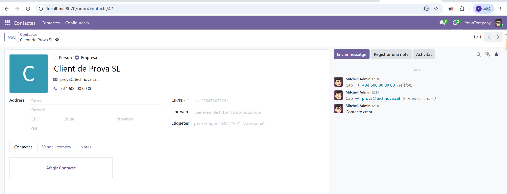
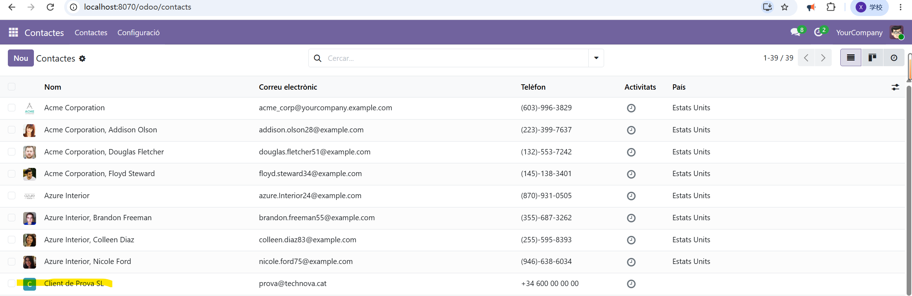

# Activitat 2.4 — Procés d'instal·lació documentat pas a pas

## MÒDUL: Desenvolupament d'aplicacions multiplataforma

RA2: Implanta sistemes ERP-CRM interpretant la documentació tècnica i identificant les diferents opcions i mòduls.

## RECURSOS

 - Teoria RA2

## CONDICIONS DE TREBALL

 - Treball individual.
 - Entregar al Moodle l'enllaç del github.
 - Github:
   - Treballar en el mateix repositori de la **RA1**.
   - Treballar en la branca **ra2**.
   - En acabar l'activitat, fusionar la branca **ra2** a la branca **main** del github.    

## AVALUACIÓ

 - Activitat avaluable amb **A** (Apte) o **NA** (No Apte).
 - Condicions per a **Apte**:
   - 100% de l'activitat demanada.
   - Entregar l'activitat a la data indicada.
   - Treballar amb branca i l'ús de commits.
 - Entregar en format **.md** (markdown) amb la mateixa nomenclatura que el de l'activitat actual.

## ENUNCIAT

Munteu una **instal·lació nova** d'Odoo (una carpeta i un `docker-compose.yml` diferents dels que ja teniu, perquè no interfereixi amb les vostres bases de dades actuals).

**IMPORTANT!!** Si teniu engegada l'altra instal·lació, les dues faran servir el port 8069 i la nova no arrencarà (error de port ocupat). Abans d'aixecar la nova, atureu l'altra (`docker compose down` a la seva carpeta) o canvieu el port de la nova al `docker-compose.yml` (per exemple `"8070:8069"`, i llavors hi accediu per `http://localhost:8070`).

Per a **cada pas** del procés, ompliu una fitxa amb aquest format:

* **Pas:**
* **Acció/comanda executada:**
* **Resultat obtingut:**
* **Captura de pantalla:**

Els passos mínims a documentar són:

1. Comprovació dels requisits previs (SO, Docker instal·lat i en marxa).
2. Creació del fitxer `docker-compose.yml` (contenidors `odoo` i `db`), amb els volums `odoo-db-data` (bases de dades) i `odoo-web-data` (imatges, adjunts i sessions d'Odoo). Expliqueu per a què serveix cada volum (vegeu la teoria del RA2, apartat «Fitxer de configuració odoo.conf»).
3. Creació del fitxer `odoo.conf` i muntatge al `docker-compose.yml` (vegeu la teoria del RA2, apartat «Fitxer de configuració odoo.conf»).
4. Aixecar els contenidors (`docker compose up -d`).
5. Primer accés des del navegador i creació de la base de dades de l'empresa (Master Password, i usuari i contrasenya de l'administrador: camps *Email* i *Password*).
6. Instal·lació d'un primer mòdul (p. ex. Contactes).
7. Comprovació que tot funciona: crear un registre de prova (un contacte).

## Com entregar-ho

Un document amb les 7 fitxes (o més, si voleu detallar-ho més) completades amb les captures corresponents.


## Pas 1 — Comprovació dels requisits previs

* **Pas:** Comprovar el sistema operatiu i que Docker està instal·lat i en marxa, i veure si hi ha contenidors de la instal·lació anterior.
* **Acció/comanda executada:**
  ```bash
  docker ps
  docker volume ls
  ```
* **Resultat obtingut:** Docker Desktop en marxa. L'ordre docker ps respon correctament, així que el dimoni de Docker funciona, i docker volume ls mostra els volums existents de la instal·lació anterior. La instal·lació anterior (odoo_prova) estava engegada i utilitza el port 8069, de manera que he canviat el port de la nova instal·lació a 8070:8069 al docker-compose.yml.
* **Captura de pantalla:** 

---

## Pas 2 — Creació del fitxer `docker-compose.yml`

* **Pas:** Crear la carpeta nova del projecte i el fitxer `docker-compose.yml` amb els serveis `odoo` i `db` i els volums `odoo-db-data` i `odoo-web-data`.
* **Acció/comanda executada:** Crear la carpeta `odoo-prova1` i dins el fitxer `docker-compose.yml` i posar aixo
  ```
  services:
    odoo:
      image: odoo:19
      depends_on:
        - db
      ports:
        - "8070:8069"
      environment:
        - HOST=db
        - USER=odoo
        - PASSWORD=odoo
      volumes:
        - ./config:/etc/odoo
        - odoo-web-data:/var/lib/odoo
    db:
      image: postgres:15
      environment:
        - POSTGRES_USER=odoo
        - POSTGRES_PASSWORD=odoo
        - POSTGRES_DB=postgres
      volumes:
        - odoo-db-data:/var/lib/postgresql/data
  volumes:
    odoo-db-data:
    odoo-web-data:
  ```
* **Resultat obtingut:**  He creat la carpeta odoo_prova1 amb el fitxer docker-compose.yml, amb els serveis odoo i db i els volums odoo-db-data i odoo-web-data. He posat el port 8070 perquè el 8069 ja el vaig servir.

| Volum | Ruta dins el contenidor | Funció |
|---|---|---|
| `odoo-db-data` | `/var/lib/postgresql/data` (servei `db`) | Guarda les **bases de dades de PostgreSQL**, és a dir, tota la informació de l'empresa. |
| `odoo-web-data` | `/var/lib/odoo` (servei `odoo`) | Guarda el ***filestore*** d'Odoo: imatges, adjunts (logos inclosos) i sessions dels usuaris. |
* **Captura de pantalla:** 

---

## Pas 3 — Creació del fitxer `odoo.conf` i muntatge al `docker-compose.yml`

* **Pas:** Crear el fitxer de configuració d'Odoo a la carpeta `config/` i muntar-lo al contenidor.
* **Acció/comanda executada:** Crear `config/odoo.conf` i posar aixo:
  ```
  [options]
  admin_passwd = Mestra_2627
  db_host = db
  db_port = 5432
  db_user = odoo
  db_password = odoo
  addons_path = /mnt/extra-addons
  data_dir = /var/lib/odoo
  ```

  Muntatge al servei `odoo` del `docker-compose.yml`:
  ```yaml
  volumes:
    - ./config:/etc/odoo
  ```
* **Resultat obtingut:** Fitxer creat i muntat: la carpeta `config` del projecte substitueix `/etc/odoo` del contenidor, on Odoo llegeix `odoo.conf`.
* **Captura de pantalla:** 

### Què fa cada paràmetre

* `admin_passwd`: la Master Password que demanarà el Database Manager.
* `db_host`, `db_port`, `db_user`, `db_password`: connexió amb PostgreSQL
* `addons_path`: carpeta on Odoo busca mòduls addicionals.
* `data_dir`: carpeta on Odoo desa el *filestore* (adjunts i imatges).


---

## Pas 4 — Aixecar els contenidors

* **Pas:** Crear i arrencar els contenidors en segon pla i comprovar que funcionen.
* **Acció/comanda executada:**
  ```bash
  docker compose up -d
  docker ps
  docker volume ls
  ```
* **Resultat obtingut:** He executat docker compose up -d a la carpeta odoo_prova1. Docker ha descarregat les imatges odoo:19 i postgres:15 i ha creat i arrencat els contenidors odoo i db en segon pla. Amb docker ps he comprovat que tots dos estan en marxa (Up) i que el port 8070 de l'equip està mapejat al port 8069 del contenidor d'Odoo. Amb docker volume ls he comprovat que s'han creat els volums odoo_prova1_odoo-db-data i odoo_prova1_odoo-web-data.
* **Captura de pantalla:** 

---

## Pas 5 — Primer accés des del navegador i creació de la base de dades

* **Pas:** Accedir a Odoo i crear la base de dades de l'empresa.
* **Acció/comanda executada:** Obrir `http://localhost:8070` al navegador i omplir el formulari de creació de la base de dades:
(de pas 3) i Create database
* **Resultat obtingut:** Es crea la base de dades i s'entra a Odoo
* **Captura de pantalla:**



---

## Pas 6 — Instal·lació d'un primer mòdul

* **Pas:** Activar el mòdul 'Contactes' des d'Apps.
* **Acció/comanda executada:** Aplicacions i cercar "Contactes" i activar
* **Resultat obtingut:** El mòdul s'activa i apareix al desplegable del menú d'aplicacions.
* **Captura de pantalla:**


---

## Pas 7 — Comprovació que tot funciona: contacte de prova

* **Pas:** Crear un contacte de prova i comprovar que les dades es desen i persisteixen.
* **Acció/comanda executada:** Contactes/new/omplir nom ( "Client de Prova SL"). Després, comprovació de persistència:
  ```
  docker compose down
  docker compose up -d
  ```
  Tornar a entrar a `http://localhost:8070` i comprovar que el contacte hi continua.
* **Resultat obtingut:** Després del `down` i `up -d`, el contacte i la sessió/imatges es mantenen.
* **Captura de pantalla:**


