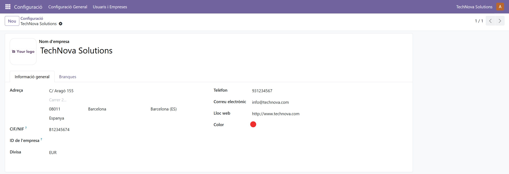
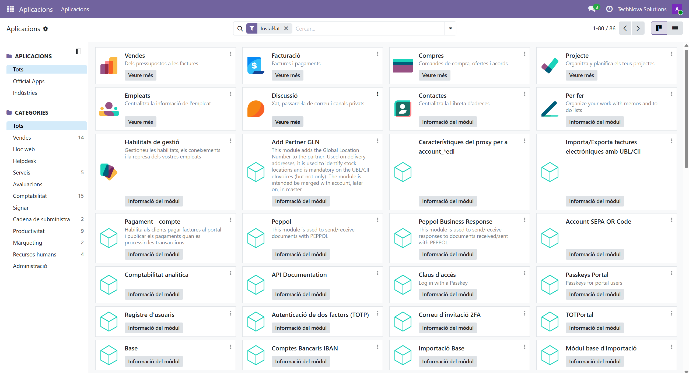
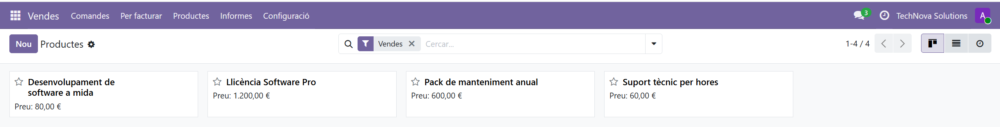
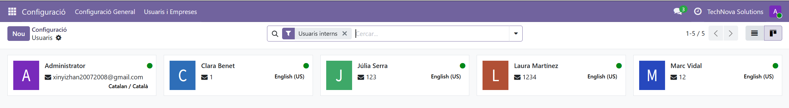
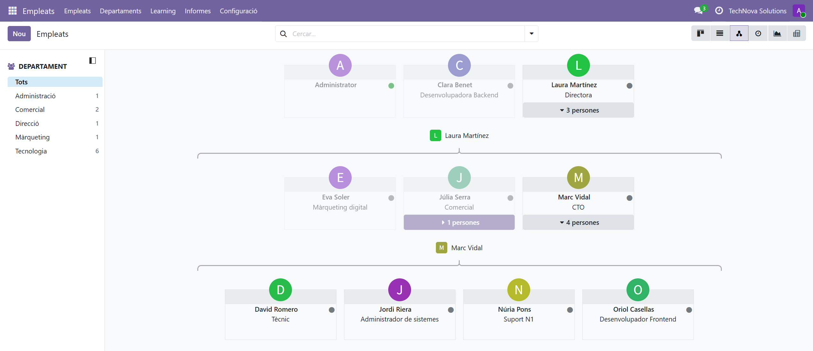
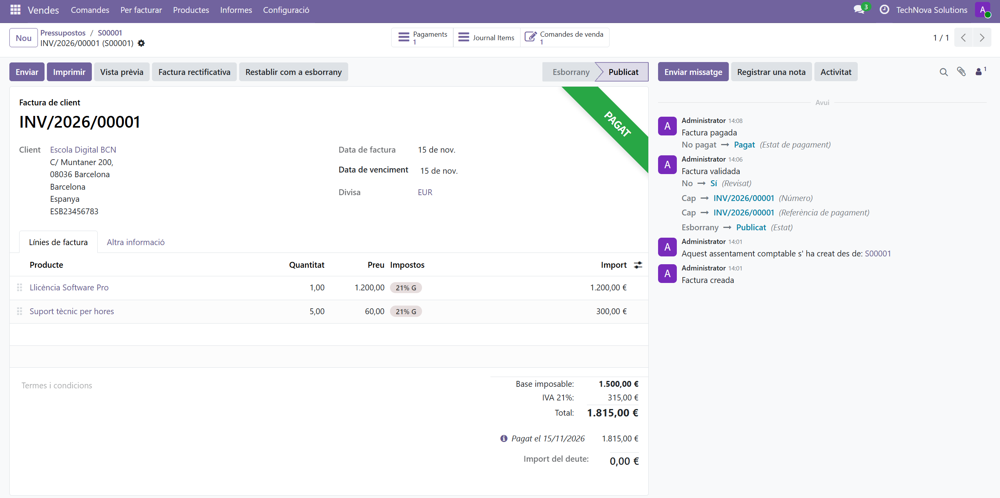
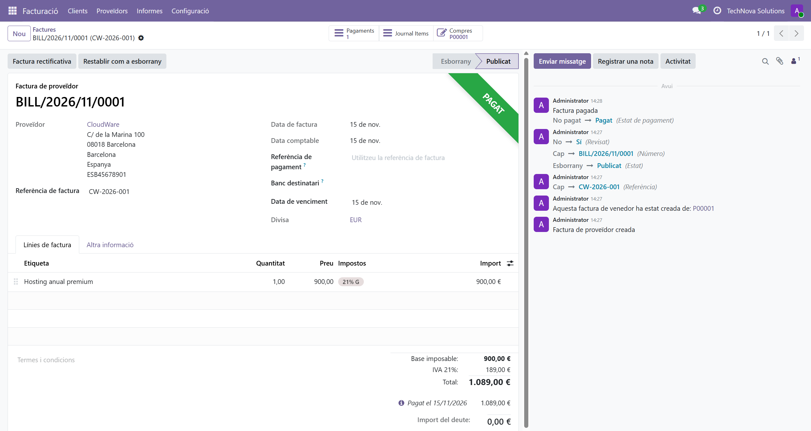
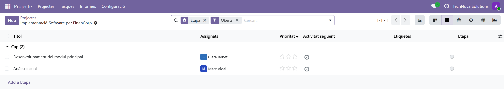

# **Activitat 2.2 - Implantació d’Odoo a Technova**

## MÒDUL: Desenvolupament d'aplicacions multiplataforma

RA2: Implanta sistemes ERP-CRM interpretant la documentació tècnica i identificant les diferents opcions i mòduls.

## RECURSOS

 - Teoria RA2

## CONDICIONS DE TREBALL

 - Treball individual.
 - Entregar al Moodle l'enllaç del github.
 - Github:
   - Treballar en el mateix repositori de la **RA1**.
   - Treballar en la branca **ra2**.
   - En acabar l'activitat, fusionar la branca **ra2** a la branca **main** del github.    

## AVALUACIÓ

 - Activitat avaluable amb nota de 0 a 100.
 - Entregar l'activitat a la data indicada.
 - Treballar a la branca **ra2**.
 - Entregar en format **.md** (markdown) amb la mateixa nomenclatura que el de l'activitat actual.

## ENUNCIAT

# **1. Context**

Treballareu amb **TechNova Solutions**, una empresa de Barcelona dedicada al desenvolupament de programari i serveis IT. L’empresa ja està en funcionament i vol començar a utilitzar Odoo per gestionar les seves operacions internes: vendes, compres, projectes i relació amb clients i proveïdors.

A continuació tens tota la informació corporativa necessària per treballar. A partir d’aquest escenari, hauràs de configurar Odoo perquè l’empresa pugui operar amb normalitat. **No s’indica quins mòduls, usuaris o configuracions has d’activar: tu decideixes què cal fer.**

**IMPORTANT!!** Les dades que no s’indiquen a l’enunciat (preus dels serveis i productes, dades fiscals i adreces de clients i proveïdors, etc.) us les heu d’inventar. Indiqueu-les a l’entrega amb el text **(dada inventada)**.

# **2. Informació de l’empresa**

## **2.1 Dades generals**

* **Nom:** TechNova Solutions  
* **Sector:** Desenvolupament de programari i serveis IT  
* **Seu:** C/ Aragó 155, Barcelona  
* **CIF:** B12345678  
* **Correu corporatiu:** info@technova.com  
* **Telèfon:** 931234567

## **2.2 Serveis que ofereix l’empresa**

* Llicència Software Pro  
* Pack de manteniment anual  
* Suport tècnic per hores  
* Desenvolupament de software a mida

## **2.3 Clients principals**

* **Escola Digital BCN**  
* **FinanCorp**

## **2.4 Proveïdors habituals**

* **CloudWare:** hosting i servidors  
* **HardTech:** maquinari

## **2.5 Plantilla de treballadors**

| Nom | Rol |
| ----- | ----- |
| Laura Martínez | Directora |
| Marc Vidal | CTO |
| Júlia Serra | Comercial |
| David Romero | Tècnic |
| Clara Benet | Desenvolupadora Backend |
| Oriol Casellas | Desenvolupador Frontend |
| Núria Pons | Suport N1 |
| Jordi Riera | Administrador de sistemes |
| Eva Soler | Màrqueting digital |
| Pau Ferrer | Comercial júnior |

# **3. Tasques a realitzar**

A partir de la informació anterior, configura Odoo amb una nova BD perquè TechNova Solutions pugui operar correctament. Hauràs de decidir:

* quins mòduls cal instal·lar,  
* quins usuaris cal crear i amb quins permisos, (només 4 treballadors necessitaran accés a Odoo)  
* com s’han de configurar els serveis,  
* i com s’han de gestionar les operacions.

## **3.1 Configuració inicial**

Configura l’empresa a Odoo amb les dades proporcionades.

**Lliurable:** captura de la configuració de l’empresa.

## **3.2 Configuració del sistema**

Prepara Odoo perquè l’empresa pugui:

* gestionar vendes,  
* gestionar compres,  
* gestionar projectes,  
* gestionar clients i proveïdors,  
* gestionar serveis que es venen per hores.

**Lliurable:** captura dels mòduls instal·lats i dels usuaris creats amb els seus permisos, i justificació de quins 4 treballadors tenen accés a Odoo, per què, i per què els heu donat aquells permisos.

* Laura Martínez (Directora): necessita veure tota l'activitat comercial i econòmica.
* Júlia Serra (Comercial): és qui fa les cotitzacions i comandes als clients. Només necessita Vendes, amb accés limitat als seus propis documents.
* Marc Vidal (CTO): gestiona els projectes i els equips tècnics, així que és l'administració tècnica d'Odoo, així que té el permís de Configuració. Fa de responsable d'Odoo, i per això és l'únic amb aquest permís.
* Clara Benet (Desenvolupadora Backend): treballa als projectes. Per això té només Projecte com a usuari.

## **3.3 Operacions de venda**

El client **Escola Digital BCN** sol·licita:

* 1 Llicència Software Pro  
* 5 hores de suport tècnic

Realitza el procés complet fins que la factura quedi **pagada**.

**Lliurable:** captura de la factura pagada.

## **3.4 Operacions de compra**

L’empresa necessita renovar el hosting anual amb **CloudWare**.

Crear producte “Hosting anual premium” (Servei).

Realitza el procés complet fins que la factura del proveïdor quedi **pagada**.

**Lliurable:** captura de la factura del proveïdor pagada.

## **3.5 Projectes**

Crea un projecte per al client **FinanCorp** anomenat:

* *Implementació Software per FinanCorp*

Afegeix-hi dues tasques:

* Anàlisi inicial  
* Desenvolupament del mòdul principal

Assigna-les als empleats adequats segons el seu rol.

**Lliurable:** captura del projecte amb les tasques.

## **3.6 Pregunta final**

En 5–6 línies, explica:

**Per què és important configurar correctament els permisos i rols dels usuaris en un ERP?**

Perquè un ERP concentra la informació més sensible de l'empresa: vendes, preus, dades de clients, factures i comptabilitat. Si tothom té accés a tot, hi ha risc de fuites de canvis i esborrats per error, o fins i tot de fraus. Amb els permisos ajustats, cada persona veu i fa només el que necessita per a la seva feina. També serveix per separar funcions (qui compra no ha de ser qui paga) i per saber qui ha fet cada acció. A més, ajuda a complir la normativa de protecció de dades. Finalment, fa l'ERP es més fàcil d'usar, perquè cada treballador només veu els menús que li interessen.